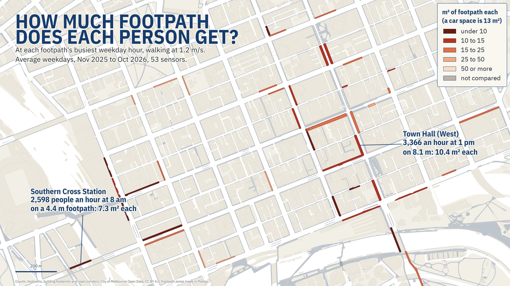
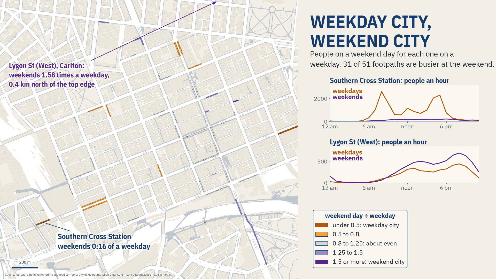

# How much footpath does each person get?

Melbourne's pedestrian counts on the footpaths they come from. **Live version, with an interactive map:** [getplotlay.com/showcase/melbourne-pedestrians](https://www.getplotlay.com/showcase/melbourne-pedestrians/)



At 8 am on a weekday, **2,598 people an hour** walk past the sensor outside Southern Cross Station, on a footpath 4.4 m wide. Walking at 1.2 m/s, that is **about 7.3 m² each, just over half a car space**. At the weekend's busiest hour the same footpath carries 207 people an hour, so each person has about 92 m².

The City of Melbourne counts people walking past more than 100 sensors, every hour. A count is a number at a point, and how crowded a footpath feels depends on its width, which the counts don't give. The council also publishes its footpaths as outlines, but not which footpath each sensor counts. The zones in this repository were made in [Plotlay](https://www.getplotlay.com) to join the two.

[](https://app.plotlay.io/?example=melbourne-pedestrians&as=client)

## What the data says

Averages from 1 November 2025 to 31 October 2026, for the 53 sensors with at least 300 complete days and a clear footpath.

| | |
|---|---|
| All 53 sensors added up, weekday | 1,051 people an hour at 4 am; 67,022 at 5 pm (64 times as many) |
| Weekend midnight against weekday midnight | 3.1 times as many people |
| Southern Cross Station, busiest weekday hour (8 am) | 2,598 an hour on 4.4 m: 7.3 m² each |
| Town Hall (West), busiest weekday hour (1 pm) | 3,366 an hour on 8.1 m: 10.4 m² each |
| Median of 51 compared footpaths, busiest hour | 16.2 m² each on weekdays, 18.1 m² at weekends |
| Weekend day ÷ weekday | Southern Cross Station 0.16; Lygon St (West), Carlton 1.58 |
| Footpaths busier at the weekend | 31 of 51 |
| Busiest day | Saturday 7 March 2026: 1,003,937 passes, 24% more than the median Saturday |

- **The city breathes.** 25 of the 53 footpaths are busiest at 5 pm on weekdays. Weekends start later and stay out later.
- **Weekday city, weekend city.** Southern Cross Station is a commuter footpath: a weekend day brings 0.16 of a weekday's walkers (2,610 against 16,313). Lygon St in Carlton is the other way round, 1.58 times a weekday, busiest at 8 pm.
- **The busiest days** were Thursday 5 to Sunday 8 March 2026, leading into the Labour Day long weekend. The public holiday itself, Monday 9 March, was quieter (748,606). The counts don't say why.
- **Real changes, not counting changes.** All 53 sensors were in place before the 12 months began, and the two busiest days had all 53 reporting all 24 hours (the Friday 52, the Thursday 51: a sensor that missed an hour is left out of that day, so those totals are, if anything, low). No sensor shows a step that would mean it moved. The biggest swings follow the calendar: Southern Cross over the summer holidays, and RMIT Building 80 with the university semester.



### Read it carefully

- **Space each is an estimate.** Space each = walking speed × 3600 × width ÷ people an hour. It assumes everyone walks at a steady 1.2 m/s, across the whole footpath width, evenly through the hour. The busiest minutes are busier, and café tables, bins and poles take up part of the width. At 1.0 m/s each person would have 17% less space.
- **Widths come from the shapes.** For a long, thin outline, W = (P − √(P² − 16A)) / 4, where A is the area and P the perimeter. That is the formula column `width_m` in Plotlay. A second method (the area over the long side of the smallest box around the shape) agrees within 20% for every compared footpath.
- **A zone is a block of footpath, as the council draws it.** People walk past a sensor, not necessarily along the whole block.
- **Checked zones only in comparisons.** 49 zones are fine and 2 were adjusted. 2 could not be verified and stay on the map, but they are left out of medians and rankings. 4 sensors have no zone. See the `zone_check` and `note` columns of [`data/counts/sensors.csv`](data/counts/sensors.csv).
- **Missing hours stay missing.** Averages use the hours each sensor reported, never filled in.

## How it was made with Plotlay

1. **A map project** on the Geoscience Australia base map, and a **Data layer** called Footpaths ([Data layers](https://www.getplotlay.com/features)).
2. **Pick from a layer.** The City of Melbourne's footpaths file, with its licence: one click takes the footpath outline under it. 52 zones were made this way.
3. **A strip** for Princes Bridge, where the council splits the footpath into a 127 m² piece at the abutment and the bridge span. A line along the bridge at the span's width (5.0 m) gives 618 m².
4. **Join by coordinates.** The sensor locations, linked from the council's portal, drop into the zone they sit in. Sensors on walls sit up to 10.8 m from their footpath, so rows within 12 m of a zone go to the nearest one. Each of them is more than 100 m from any other zone.
5. **Key the shapes by a column**: each zone takes its sensor's `location_id`.
6. **Link by address, with Refresh.** The average people in each hour of the day, weekdays and weekends, worked out by the portal's API. The hour is the time axis, and the slider loops.
7. **Formula columns**: `width_m`, `weekend_vs_weekday` and `m2_each_at_peak`.
8. **Colour** by people an hour divided by `width_m`, with breaks at 100, 250 and 500, and **Show in 3D**.
9. **Summarise on the way in.** The portal's whole hourly file (1,629,587 rows), grouped by day.
10. **Export** GeoJSON, TopoJSON, CSV with WKT, every linked table and a Python starter. Nothing in this repository comes from OpenStreetMap, and no imagery was traced.

The portal addresses linked in step 6 are in [`data/README.md`](data/README.md).

## What's here

| Folder | What |
|---|---|
| [`data/geometry/`](data/geometry) | The 53 footpath zones from Plotlay: GeoJSON, TopoJSON, CSV with WKT. Key: the sensor's `location_id` |
| [`data/counts/`](data/counts) | `sensors.csv` (the 57 reliable sensors, their zones and checks), `hour_of_day.csv` (weekday and weekend hourly averages), `daily_totals.csv` |
| [`python/`](python) | A narrated notebook that recomputes every number here: [`footpaths_through_a_day.ipynb`](python/footpaths_through_a_day.ipynb) |
| [`powerbi/`](powerbi) | A Power BI Project (`.pbip`). Start with [`powerbi/OPEN-ME.md`](powerbi/OPEN-ME.md) |
| [`visuals/`](visuals) | The maps, charts and animations |

### Run the notebook

```
python3 -m venv .venv
.venv/bin/pip install -r python/requirements.txt
cd python && ../.venv/bin/jupyter lab footpaths_through_a_day.ipynb
```

### Open the Power BI report

Open `powerbi/MelbourneFootpaths.pbip` in Power BI Desktop and select Refresh. [`powerbi/OPEN-ME.md`](powerbi/OPEN-ME.md) has the steps. The Shape Map's custom map is built into the report; only the Azure Maps reference layer is added by hand.

## Sources and licences

- **Code** (notebook, Power BI project): MIT, see [`LICENSE`](LICENSE).
- **Our data** (the zones, the tables, the checks): CC BY 4.0, see [`LICENSE-DATA`](LICENSE-DATA). Credit "Plotlay (getplotlay.com)" and the sources below.
- Pedestrian counts (Pedestrian Counting System, counts per hour) and sensor locations: City of Melbourne Open Data, data.melbourne.vic.gov.au, licensed under CC BY 4.0. Changes: averaged by hour of the day for weekdays and weekends, and added up by day.
- Footpaths, 2023 building footprints and road corridors: City of Melbourne Open Data, CC BY 4.0. The zones are the council's footpath outlines picked in Plotlay, plus one strip along a council footpath.
- Base map in the app: © Commonwealth of Australia (Geoscience Australia), CC BY 4.0.

This is independent work using open data, not endorsed by the City of Melbourne. Full credits are in [`NOTICE`](NOTICE).
